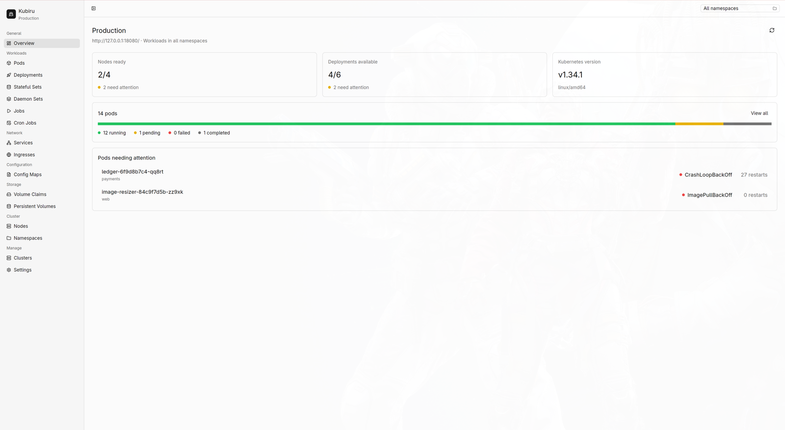
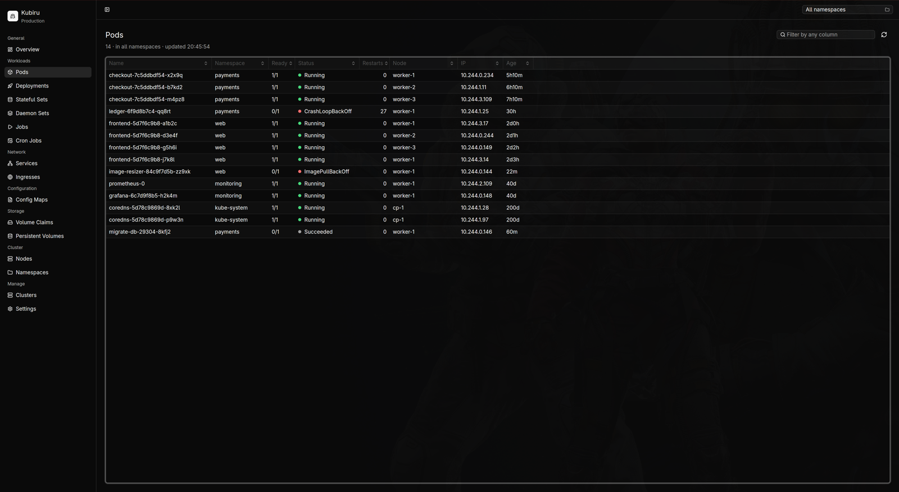
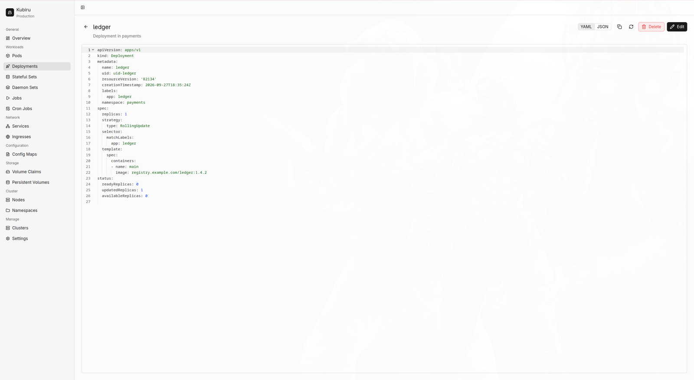
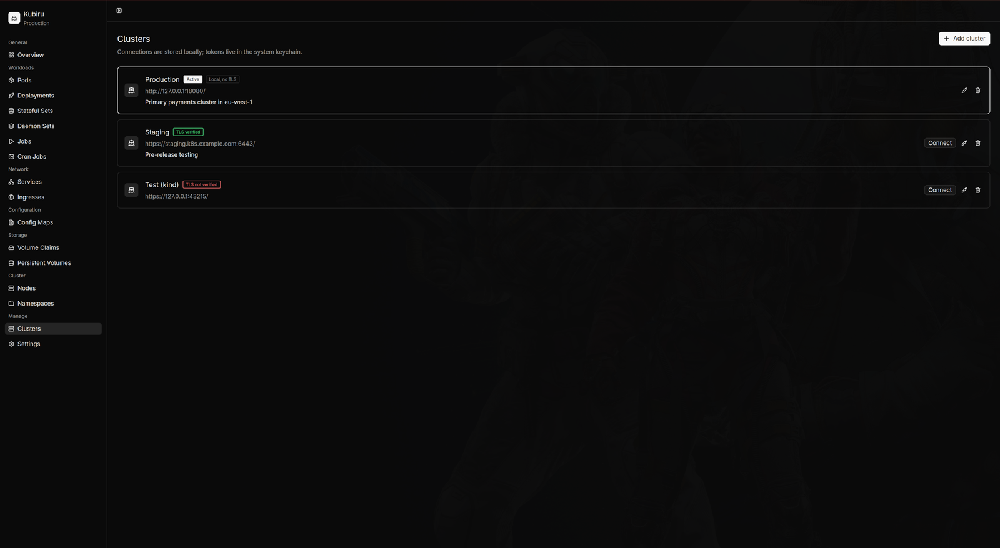

<div align="center">

# Kubiru

**A fast, native desktop client for Kubernetes.**

Browse workloads, read and edit manifests, and keep an eye on cluster health,
in a GPU-accelerated window that starts instantly and keeps your credentials
in the operating system's keychain.

[](https://github.com/phoscoder/kubiru/actions/workflows/ci.yml)
[](LICENSE)
[](https://gpui-kit.com)
[](https://www.rust-lang.org)



</div>

## Contents

- [Features](#features)
- [Screenshots](#screenshots)
- [Installation](#installation)
- [Getting started](#getting-started)
- [Keyboard shortcuts](#keyboard-shortcuts)
- [Security](#security)
- [Where your data lives](#where-your-data-lives)
- [Development](#development)
- [Roadmap](#roadmap)
- [Contributing](#contributing)
- [License](#license)

## Features

- **Many clusters, one window.** Save any number of clusters and switch between them from the sidebar.
- **Overview at a glance.** Node and deployment health, the Kubernetes version, pods by phase, and the failing pods with the most restarts, each one click away.
- **13 resource types.** Pods, Deployments, StatefulSets, DaemonSets, Jobs, CronJobs, Services, Ingresses, ConfigMaps, PersistentVolumeClaims, PersistentVolumes, Nodes and Namespaces.
- **kubectl-style tables.** The same columns and status logic as `kubectl get` (for example `CrashLoopBackOff` and `Init:ImagePullBackOff`), colour-coded health, natural sorting on any column and instant filtering.
- **Manifests in YAML or JSON.** Syntax-highlighted, searchable and read-only by default. Edit and apply in place, with guards that stop an edit from renaming or moving the object or overwriting someone else's change.
- **Safe deletes.** Every destructive action asks first and says exactly what will happen.
- **Namespace switcher.** Searchable, remembered per cluster.
- **Keyboard first.** Every main view has a shortcut, and tables are fully navigable with arrow keys and Enter.
- **Light and dark themes** that follow the system or a fixed choice.
- **Native and fast.** Built in Rust on [GPUI](https://www.gpui.rs) through [GPUI Kit](https://gpui-kit.com). No browser, no Electron, no Node.js.

## Screenshots

| Resource table (dark)                         | Manifest viewer                             |
| --------------------------------------------- | ------------------------------------------- |
|  |  |

| Cluster management (dark)                                 |
| --------------------------------------------------------- |
|  |

## Installation

Kubiru is distributed as source for now; prebuilt packages are on the [roadmap](#roadmap).

### Requirements

- The latest stable [Rust toolchain](https://rustup.rs) (the repository pins `stable` in `rust-toolchain.toml`)
- A GPU driver with Vulkan (Linux), Metal (macOS) or DirectX (Windows) support
- A system keychain: Keychain on macOS, Credential Manager on Windows, or a Secret Service provider (GNOME Keyring, KWallet, KeePassXC) on Linux

On Linux, install the build dependencies first:

```sh
# Debian / Ubuntu
sudo apt install pkg-config libdbus-1-dev libfontconfig-dev libfreetype-dev \
  libwayland-dev libxcb1-dev libxkbcommon-dev libxkbcommon-x11-dev libvulkan-dev

# Fedora
sudo dnf install pkgconf-pkg-config dbus-devel fontconfig-devel freetype-devel \
  wayland-devel libxcb-devel libxkbcommon-devel libxkbcommon-x11-devel vulkan-loader-devel

# Arch Linux
sudo pacman -S --needed pkgconf dbus fontconfig freetype2 wayland libxcb libxkbcommon libxkbcommon-x11 vulkan-icd-loader
```

### Build and run

```sh
git clone https://github.com/phoscoder/kubiru.git
cd kubiru
cargo run --release
```

To install the binary into `~/.cargo/bin`:

```sh
cargo install --path crates/kubiru --locked
```

## Getting started

Kubiru connects straight to the Kubernetes API server with a **bearer token**.
You need two things:

1. **The API server address**, for example `https://10.0.0.1:6443`. To print it for your current kubectl context:

   ```sh
   kubectl config view --minify -o jsonpath='{.clusters[0].cluster.server}'
   ```

2. **A token** for a service account. Grant only the access you need. For a read-only setup:

   ```sh
   kubectl create serviceaccount kubiru -n kube-system
   kubectl create clusterrolebinding kubiru-view --clusterrole=view --serviceaccount=kube-system:kubiru
   kubectl create token kubiru -n kube-system --duration=24h
   ```

   Editing and deleting from Kubiru needs a role that allows `update` and `delete` (for example `edit`). Kubiru can never do more than the token allows.

Then open Kubiru, choose **Add a cluster**, paste both values and press **Test connection** before saving.

If the cluster uses a private certificate authority (as `kubeadm`, kind and most on-premises clusters do), paste its PEM certificate in **Certificate authority**. You can extract it with:

```sh
kubectl config view --raw --minify -o jsonpath='{.clusters[0].cluster.certificate-authority-data}' | base64 -d
```

> [!WARNING]
> **Skip TLS certificate verification** is available for throwaway local clusters, but with it anyone on the network path could impersonate the cluster and capture your token. Prefer adding the CA certificate.

Plain `http://` is only accepted for loopback addresses, so you can point Kubiru at `kubectl proxy`:

```sh
kubectl proxy --port=8001   # then use http://127.0.0.1:8001 as the API server address
```

## Keyboard shortcuts

`Mod` is <kbd>⌘ Cmd</kbd> on macOS and <kbd>Ctrl</kbd> on Linux and Windows.

| Shortcut | Action |
| --- | --- |
| <kbd>Mod</kbd>+<kbd>1</kbd> | Overview |
| <kbd>Mod</kbd>+<kbd>2</kbd> … <kbd>5</kbd> | Pods, Deployments, Services, Nodes |
| <kbd>Mod</kbd>+<kbd>Shift</kbd>+<kbd>K</kbd> | Clusters |
| <kbd>Mod</kbd>+<kbd>,</kbd> | Settings |
| <kbd>Mod</kbd>+<kbd>N</kbd> | Add a cluster |
| <kbd>Mod</kbd>+<kbd>R</kbd> or <kbd>F5</kbd> | Refresh the current view |
| <kbd>Mod</kbd>+<kbd>F</kbd> | Filter the current table |
| <kbd>Mod</kbd>+<kbd>B</kbd> | Show or hide the sidebar |
| <kbd>↑</kbd> <kbd>↓</kbd> <kbd>Enter</kbd> | Move through a table and open the selected object |
| <kbd>Mod</kbd>+<kbd>C</kbd> | Copy the selected object's name |
| <kbd>Delete</kbd> | Delete the selected object (asks first) |
| <kbd>Mod</kbd>+<kbd>S</kbd> | Apply manifest edits |
| <kbd>Esc</kbd> | Back from a manifest |
| <kbd>Mod</kbd>+<kbd>Q</kbd> | Quit |

## Security

Kubiru holds credentials that can change production systems, so it is built defensively:

- **Tokens never touch the disk in plain text.** They are kept in the operating system's keychain, are never logged, and Kubiru's own in-memory copy is zeroed when it is dropped.
- **TLS is verified by default**, against the system roots or a CA you provide. Turning verification off is an explicit, per-cluster choice with a visible warning.
- **The token only goes to the server you configured.** HTTP redirects are refused, plain HTTP is only allowed on loopback, and credentials embedded in URLs are rejected.
- **Names are validated** against Kubernetes naming rules before they are placed in a request path, so crafted values cannot redirect a request.
- **Edits cannot escape their object.** Applying a manifest that changes its kind, API version, name, namespace or UID is refused, and the object's `resourceVersion` makes concurrent changes fail rather than be overwritten.
- **Bounded requests.** Every request has connect and overall timeouts, and response sizes are capped.
- **No `unsafe` code** in Kubiru itself (forbidden by lint), and dependencies are audited against the RustSec database in CI.

Please report vulnerabilities privately as described in [SECURITY.md](SECURITY.md).

## Where your data lives

| What | Where |
| --- | --- |
| Bearer tokens | The system keychain, under the service `dev.kubiru.Kubiru` |
| Cluster names, addresses, CA certificates, preferences | A SQLite database, readable only by your user |

The database is stored in the platform data directory:

| Platform | Path |
| --- | --- |
| Linux | `$XDG_DATA_HOME/kubiru/kubiru.sqlite3` (usually `~/.local/share/kubiru/`) |
| macOS | `~/Library/Application Support/dev.Kubiru.Kubiru/kubiru.sqlite3` |
| Windows | `%APPDATA%\Kubiru\Kubiru\data\kubiru.sqlite3` |

The exact path is shown under **Settings → Local data**. Kubiru sends no telemetry and makes no network requests other than to the clusters you add.

## Development

The workspace has two crates:

| Crate | Purpose |
| --- | --- |
| [`kubiru-core`](crates/kubiru-core) | Everything without a UI: cluster validation, SQLite storage, keychain access, the Kubernetes API client, and the table, manifest and overview logic. |
| [`kubiru`](crates/kubiru) | The desktop application, built with [GPUI Kit](https://gpui-kit.com). |

```sh
cargo run                                   # run the app
cargo test --workspace                      # unit, HTTP integration and headless UI tests
cargo clippy --workspace --all-targets      # lint
cargo fmt --all                             # format
```

See [docs/ARCHITECTURE.md](docs/ARCHITECTURE.md) for how the pieces fit together and [CONTRIBUTING.md](CONTRIBUTING.md) for the workflow.

## Roadmap

- [ ] Prebuilt, signed packages for macOS, Windows and Linux (AppImage, Flatpak)
- [ ] Import clusters from a kubeconfig file, including exec and OIDC credential plugins
- [ ] Live updates using watch requests instead of manual refresh
- [ ] Pod logs and `exec` into containers
- [ ] Scale and restart workloads
- [ ] Create resources from YAML
- [ ] Events, Secrets (with values hidden by default) and custom resources
- [ ] Command palette

Ideas are welcome as [feature requests](https://github.com/phoscoder/kubiru/issues/new/choose).

## Contributing

Contributions of all sizes are welcome. Please read [CONTRIBUTING.md](CONTRIBUTING.md) and follow the [Code of Conduct](CODE_OF_CONDUCT.md).

## License

Kubiru is released under the [MIT License](LICENSE).

## Acknowledgements

- [GPUI](https://www.gpui.rs), the UI framework behind the [Zed](https://zed.dev) editor
- [GPUI Kit](https://gpui-kit.com) and [GPUI Component](https://github.com/longbridge/gpui-component) by Longbridge
- [Lucide](https://lucide.dev) icons
- Everyone who worked on the original web version of Kubiru
